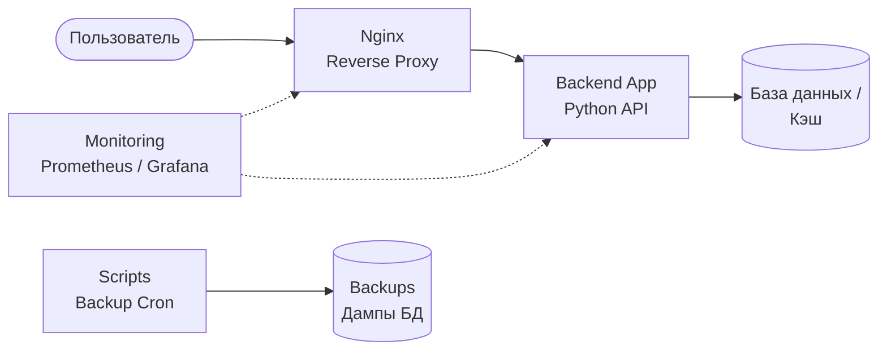

# URL Shortener Service (Production-Ready DevOps Infrastructure)


Высокодоступный сервис сокращения ссылок с полноценной production-инфраструктурой: контейнеризацией, обратным проксированием, мониторингом метрик и автоматическим резервным копированием данных.

## Архитектура проекта

Вся инфраструктура оркестрируется через **Docker Compose** и разделена на изолированные сервисы для приема трафика, обработки бизнес-логики, хранения данных и сбора метрик:



## Реализованные DevOps практики

- **Контейнеризация и оркестрация (`Dockerfile` & `docker-compose.yml`):**
  - Многосервисная сборка с изоляцией контейнеров во внутренней Docker-сети.
  - Конфигурация приложения вынесена в переменные окружения (`.env`), а лишние файлы исключены из контекста сборки через `.dockerignore`.
  - Настроены политики перезапуска контейнеров (`restart: unless-stopped`) и проверки состояния (`HEALTHCHECK`).

- **Reverse Proxy и балансировка (`nginx/`):**
  - **Nginx** выступает единой точкой входа, проксируя запросы к backend-приложению.
  - Настроено сжатие трафика (`gzip`), таймауты соединений и базовые заголовки безопасности.

- **Мониторинг и наблюдаемость (`monitoring/`):**
  - Выделенный стек мониторинга для отслеживания доступности сервиса, времени отклика (latency), кодов ответов HTTP и утилизации ресурсов контейнеров.

- **Резервное копирование и автоматизация (`scripts/` & `backups/`):**
  - Скрипты автоматического создания и ротации бэкапов данных с сохранением дампов в директорию `backups/`.

## Локальный запуск (через Makefile)

Для удобного управления стеком локально и на сервере используется `Makefile` *(проверьте названия таргетов в вашем `Makefile`)*:

```bash
# Собрать образы и запустить все сервисы в фоновом режиме
make up

# Посмотреть статус контейнеров и их состояние
make status

# Посмотреть логи сервисов в реальном времени
make logs

# Создать резервную копию базы данных вручную
make backup

# Пересобрать контейнеры после внесения изменений в код
make restart

# Остановить сервисы и очистить ресурсы
make down
```

## Структура проекта

```text
.
├── app/                   # Исходный код сервиса сокращения ссылок
├── backups/               # Директория для хранения резервных копий
├── monitoring/            # Конфигурация мониторинга и дашбордов
├── nginx/                 # Конфигурационные файлы Nginx (reverse proxy)
├── scripts/               # Скрипты автоматизации и резервного копирования
├── .dockerignore          # Исключения для сборки Docker-образа
├── .env                   # Переменные окружения (рекомендуется заменить на .env.example)
├── .gitignore             # Исключения для Git
├── Dockerfile             # Сборка образа приложения
├── Makefile               # Автоматизация управления проектом
├── docker-compose.yml     # Описание и оркестрация всех сервисов
├── requirements.txt       # Python-зависимости приложения
└── README.md              # Документация проекта
```
